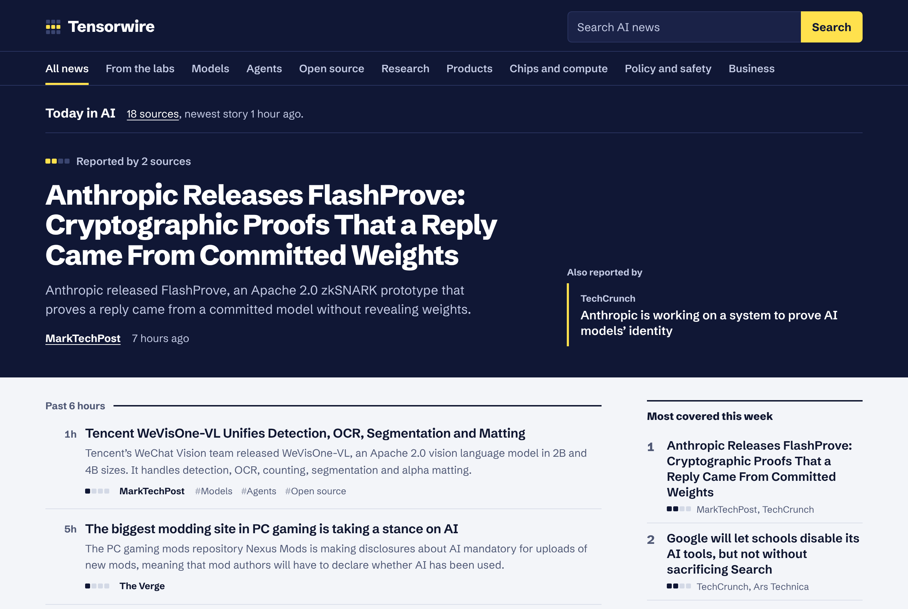
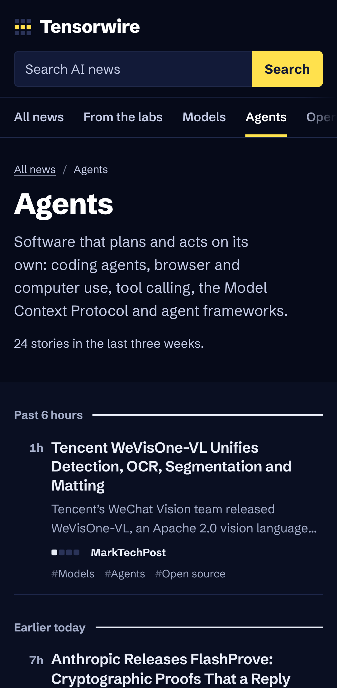

# Tensorwire

**Live: [tensorwire.vercel.app](https://tensorwire.vercel.app)**

Today's AI news on one page. Tensorwire reads 58 feeds, from AI labs, newsrooms and independent builders, every 15 minutes. When several outlets report the same news, it shows up once with every source listed, and the story most outlets are covering leads the page.

<p align="center">
  
  &nbsp;
  
</p>

| Lighthouse | Performance | Accessibility | Best practices | SEO |
|---|---|---|---|---|
| Mobile | 93–99 | 100 | 100 | 100 |
| Desktop | 100 | 100 | 100 | 100 |

## Features

- **One story, all its coverage.** Reports of the same news are grouped automatically. The lab's own post leads when there is one, and the other coverage is listed under it.
- **News only.** Tutorials, listicles ("7 free books to…"), explainers, talks and event promotions are left out, so the page stays on what happened. The labs' own posts are always kept.
- **Coverage cells.** A row of up to four cells shows how many sources picked up a story, so the big stories stand out as you scroll.
- **Official posts are marked**, so an announcement is never confused with reporting about it. [From the labs](https://tensorwire.vercel.app/labs) shows only those.
- **Eight topics:** models, agents, open source, research, products, chips and compute, policy and safety, business. Each has its own page.
- **A page per source** and a [sources page](https://tensorwire.vercel.app/sources) showing whether each feed loaded on its last check.
- **Search** across headlines and summaries from the last three weeks.
- **New since your last visit:** stories that arrived since you last looked are marked. Only a timestamp is stored, in your browser.
- **Two ways to read:** every story has a "Read on <publisher>" button. When the feed carries the whole post, it also gets "Read here · 4 min", the reader view. It opens the text alone on a quiet page: no menus, sidebar or footer, a serif reading font, a reading-progress bar, and text size, typeface and theme settings that are remembered. The text comes only from the publisher's own feed (never scraped from their website), images and embeds stay on the original, every page links to it, and reader pages are kept out of search engines. The [sources page](https://tensorwire.vercel.app/sources) shows which feeds carry full posts.
- **Light, dark or system theme:** switch in the header. Your choice is saved in your browser and applied before the page paints, so a dark page never flashes white. Without a choice, the site follows your system setting.
- **Its own [RSS feed](https://tensorwire.vercel.app/feed.xml)** with each story once.
- **Works without JavaScript.**

### Sources

| Labs and companies | Newsrooms | Builders and newsletters |
|---|---|---|
| OpenAI, Google DeepMind, Google AI blog, Google Research, Hugging Face, Microsoft Research, NVIDIA, NVIDIA Technical Blog, AWS Machine Learning, Apple Machine Learning Research, Meta Engineering, Google Cloud AI, Amazon Science, IBM Research, Ai2, GitHub, Cloudflare, Databricks, Together AI, Replicate, Pinecone | TechCrunch, The Verge, MIT Technology Review, Ars Technica, Wired, MarkTechPost, The Register, ZDNET, IEEE Spectrum, SiliconANGLE, MIT News, InfoQ, Unite.AI, Futurism, 404 Media, Engadget, Analytics India Magazine, Towards Data Science | Simon Willison, Latent Space, Import AI, Hacker News (LLM posts with 100+ points), Interconnects, One Useful Thing, Ahead of AI, Andrej Karpathy, Hamel Husain, Understanding AI, AI as Normal Technology, Gary Marcus, SemiAnalysis, Chips and Cheese, The Algorithmic Bridge, AI Supremacy, Exponential View, Don't Worry About the Vase, Ben's Bites |

General tech feeds (Engadget, 404 Media, ZDNET) and broad company blogs keep only their AI stories. Weekly round-ups (Exponential View, Zvi, Ben's Bites, Import AI) never join a story group, because they cover many stories at once. Every feed was tested from Vercel before it was added: feeds that block Vercel, are stale or have moved (Anthropic, Mistral, VentureBeat, The Decoder and others) are left out.

Tensorwire shows each story's headline, a short excerpt when the feed provides one, and a link to the original article. Its reader view shows only the text a publisher puts in its own feed; it never copies articles from publishers' websites.

## Tech stack

| Area | Choice |
|---|---|
| Framework | [Next.js 16](https://nextjs.org) (App Router, Server Components, Route Handlers, Proxy) |
| Language | TypeScript (strict) |
| UI | React 19, hand-written CSS, Schibsted Grotesk self-hosted from npm |
| Feeds | RSS 2.0, RSS 1.0 and Atom parsed with [fast-xml-parser](https://github.com/NaturalIntelligence/fast-xml-parser); text cleaned with [entities](https://github.com/fb55/entities) |
| Caching | `unstable_cache` per feed, 15 minutes, on the Vercel Data Cache |
| Tests | Vitest (80 unit and API tests), Playwright (95 end-to-end runs on desktop and mobile), axe-core accessibility checks |
| CI | GitHub Actions: dependency audit, lint, type check, unit tests, build, end-to-end tests; Dependabot weekly |
| Hosting | Vercel |

## How it works

```
58 RSS/Atom feeds ──▶ fetch + parse ──▶ clean + filter ──▶ topics ──▶ group ──▶ pages, RSS, sitemap
                      (each cached       (plain text,       (keyword   (same news
                       15 minutes)        safe URLs,         rules)     → one story)
                                          per-source rules)
```

- **Each feed is fetched and cached on its own** (`src/lib/feeds.ts`). A slow or broken feed never holds up the others: it times out after 10 seconds, is reported on the sources page, and the rest of the site carries on. Only the cleaned stories are cached, not the raw XML, which can be several megabytes.
- **Everything after the fetch is pure functions with unit tests**: parsing (`parse.ts`), cleaning and filtering (`stories.ts`), topics (`topics.ts`) and grouping (`cluster.ts`).
- **Feed text is treated as untrusted.** HTML is reduced to plain text and rendered as text by React, never as HTML. Links must be `http(s)`, tracking parameters are removed, and responses over 5 MB are refused.
- **Some sources cover more than AI**, so per-source rules keep only the relevant posts. NVIDIA loses its gaming posts, MIT Technology Review its sponsored posts, and Simon Willison's blog only keeps posts tagged AI or LLMs.

### How stories are grouped

Two stories from different sources, published within three days of each other, are the same news when:

1. their headlines share a word that few other headlines use (about 1% of them, like *Hydrogen*, unlike *Google* or *Gemini*), plus at least one more word; or
2. their headlines share three words, one of them fairly uncommon (*decision*, *API*), making up nearly a third of the headlines; or
3. they share at least two words that **no other story on the wire uses**. Each word scores 2 if it is in both headlines, 1 if it is in one, and 0.5 if it is only in the summaries, and the total must reach 2.

The third rule catches "Scaling Git at OpenAI" and "OpenAI Introduces Pando: A Git Backend…", which share the rare words *Pando*, *Git* and *backend*. It ignores "Claude's new rules against game cloning" and "How 'reverse game theory' could keep AI agents in check", whose shared words (*game*, *rules*) appear elsewhere too. Round-up newsletters never join a group, because they mention everything. The unit tests pin these cases on a saved snapshot of the real feeds.

Groups only join when most of their stories match each other, so a chain of loose matches (A like B, B like C) never pulls unrelated news together. Three different Google launches in one week stay three stories.

## SEO

- A unique title, description, canonical URL and social image on every page. Topic pages have their own generated images.
- Topic, source and "From the labs" pages are indexable landing pages, each with its own introduction.
- `sitemap.xml` lists every page with the time of its newest story; `robots.txt` points to it. Search results are `noindex, follow`.
- Structured data: `WebSite` with a search action and an `ItemList` of top stories on the home page; `CollectionPage`, `ItemList` and `BreadcrumbList` on section pages.
- An RSS `<link rel="alternate">` on every page, a web app manifest and icons.
- Unknown topics and sources return a real `404`.
- Google Search Console verification through `GOOGLE_SITE_VERIFICATION`.

## Security and accessibility

- A strict Content Security Policy with a fresh nonce on every request (`src/proxy.ts`), plus `X-Frame-Options`, `Referrer-Policy`, HSTS and a `Permissions-Policy` that switches everything off.
- No API keys at all: every source is a public feed.
- Feed HTML shown in the reader view is cleaned with [sanitize-html](https://github.com/apostrophecms/sanitize-html) to an allowlist of text elements: no scripts, styles, event handlers, forms, iframes or images; links are made absolute, limited to http(s) and mailto, and marked `nofollow`.
- Google Analytics is opt-in through `GA_MEASUREMENT_ID` and loads under the same nonce-based policy.
- Landmarks, a skip link, visible focus, a single `h1` per page, readable contrast in both themes, spoken ages for the time column ("3 hours ago"), and coverage cells with a text label. End-to-end tests run axe-core on every page type and fail on any serious WCAG 2.1 AA issue.

## Run it locally

You need Node.js 20.9 or newer.

```bash
npm install
npm run dev                      # http://localhost:3000, live feeds
```

To work offline, use the built-in snapshot of the real feeds (taken on 4 November 2026):

```bash
NEWS_SAMPLE_DATA=1 npm run dev
```

### Environment variables

All are optional.

| Name | What it does |
|---|---|
| `SITE_URL` | Public address for canonical links, the sitemap and social cards. Defaults to `https://tensorwire.vercel.app` on Vercel and `http://localhost:3000` elsewhere. |
| `GA_MEASUREMENT_ID` | Google Analytics 4 measurement ID (`G-…`). When set, the Google tag loads with the page's CSP nonce; when unset, nothing from Google loads. |
| `GOOGLE_SITE_VERIFICATION` | The `content` value of Google Search Console's HTML tag verification. |
| `NEWS_SAMPLE_DATA` | Set to `1` to use the snapshot in `src/lib/fixtures` instead of live feeds. Ignored in Vercel production. |

## Scripts

| Command | What it does |
|---|---|
| `npm run dev` | Start the development server |
| `npm run build` / `npm start` | Build and run the production server |
| `npm run lint` | ESLint |
| `npm run typecheck` | Generate route types and run the TypeScript compiler |
| `npm test` | Unit and API tests (Vitest) |
| `npm run test:e2e` | End-to-end and accessibility tests with Playwright, against the production build and the snapshot |

Before running `npm run test:e2e` the first time, install the browser with `npx playwright install chromium`, and build with `NEWS_SAMPLE_DATA=1 npm run build`.

## Adding a source

Add an entry to `SOURCES` in `src/lib/sources.ts`, with a slug, name, homepage, feed URL, kind and a one-line description. Add `include` to filter its posts and `summaries: false` if its descriptions aren't useful. Then add a few items for it to `src/lib/fixtures/snapshot.json`; a unit test checks that every source has sample data.

## Deploy to Vercel

1. Import this repository in Vercel. It detects Next.js; there are no settings to change.
2. Optionally add `GA_MEASUREMENT_ID` and `GOOGLE_SITE_VERIFICATION` under **Settings → Environment Variables**.
3. Deploy. Every push to `main` deploys again.

## Project structure

```
src/
  app/
    page.tsx                  Front page
    labs/, topic/[slug]/, source/[slug]/   Section pages (+ topic social images)
    sources/, about/, search/
    read/[id]/                Reader view (noindex)
    feed.xml/route.ts         Tensorwire's own RSS feed
    sitemap.ts, robots.ts, manifest.ts, opengraph-image.tsx, apple-icon.tsx, icon.svg
    layout.tsx, not-found.tsx, error.tsx, globals.css
  components/                 Frame, lead story, story list, coverage cells, side panels,
                              theme switch, reader settings
  lib/
    sources.ts                The 58 feeds and their filters
    feeds.ts                  Fetching and caching (server only)
    parse.ts                  RSS and Atom parsing
    reader.ts                 Reader view: cleaning feed HTML, reading time
    theme.ts                  Theme and reader settings, and the script that applies them before paint
    stories.ts, text.ts       Cleaning, filtering, safe URLs
    topics.ts                 Topic rules and page copy
    cluster.ts                Grouping reports of the same news
    load.ts                   One wire per request, filters, search
    time.ts, site.ts, csp.ts, analytics.ts, og.tsx
    fixtures/snapshot.json    Saved feed snapshot for development and tests
    fixtures/articles.json    Placeholder full text for two sample stories (reader view tests)
  proxy.ts                    Content Security Policy with nonces; 404 for unknown sections
e2e/                          Playwright tests
```

## History

This repository started in 2021 as "News-Fetch-Using-Mediastack", a Bootstrap page that called the Mediastack API from the browser. In 2026 it was rebuilt from scratch as Tensorwire. Mediastack's free plan allows 100 requests a month for non-commercial use, so the new site reads public feeds directly and needs no API key.

## Credits

Headlines, excerpts and the post text shown in the reader view belong to their publishers, come from their public feeds, and link to the original articles. Built by [Muhammad Shehryar](https://github.com/Shahryartariq).

## License

[MIT](LICENSE)
